```{python}
#| label: setup
# All numbers and tables come from notebooks/06-spatial_analysis.ipynb, which
# writes them to paper/results/. Re-run that notebook before rendering.
import json

import pandas as pd
from IPython.display import Markdown

R = json.loads(open("results/results.json").read())
questions = pd.read_csv("results/questions.csv", index_col=0)
wording = pd.read_csv("results/question_wording.csv", index_col=0)
shares = pd.read_csv("results/region_shares.csv", index_col=0)
regions_q10 = pd.read_csv("results/regions_q10.csv", index_col=0)
departures = pd.read_csv("results/q10_departures.csv")


def md_table(df, widths, align):
    """Pipe table with set relative column widths (dash counts), so long cells wrap
    in the wide column instead of squeezing the label column."""
    cols = list(df.columns)
    rule = {"l": ":{}", "r": "{}:", "c": ":{}:"}
    lines = ["| " + " | ".join(cols) + " |",
             "|" + "|".join(rule[a].format("-" * w) for w, a in zip(widths, align)) + "|"]
    lines += ["| " + " | ".join(str(v) for v in row) + " |" for row in df.itertuples(index=False)]
    return Markdown("\n".join(lines))


def pc(x, d=1):
    return f"{x:.{d}f}%"


def pts(x, d=1):
    return f"{x:.{d}f}"


def i2(x):
    return f"{x:.2f}"


# Question 10
q10_share = pc(R["q10_option2_pct"])
q10_o1 = f"{R['q10_option1_votes']:,}"
q10_o2 = f"{R['q10_option2_votes']:,}"
maj_ridings = " and ".join(f"{n} ({pc(p)})" for n, p in zip(R["q10_majority_ridings"], R["q10_majority_pcts"]))
n_maj = len(R["q10_majority_ridings"])
min_riding, min_pct = R["q10_min_riding"], pc(R["q10_min_pct"])
city_max = pc(R["q10_city_max_pct"])
med = R["q10_median_by_region"]
q10_reg = regions_q10["Option 2 share (%)"]

city_votes = pc(shares.loc[["Calgary", "Edmonton"], "Share of all valid votes"].sum(), 0)
city_o2 = pc(shares.loc[["Calgary", "Edmonton"], "Share of Option 2 votes"].sum(), 0)
north_land = pc(shares.loc["North", "Share of land area"], 0)
north_votes = pc(shares.loc["North", "Share of all valid votes"])
central_votes = pc(shares.loc["Central", "Share of all valid votes"], 0)
central_o2 = pc(shares.loc["Central", "Share of Option 2 votes"], 0)

# Clustering
moran = i2(R["moran_i"])
perm_max = i2(R["moran_perm_max"])
n_perm = f"{R['n_permutations']:,}"
sens = pd.Series(R["moran_sensitivity"]).drop("Shared border (main result)")
sens_min, sens_max = i2(sens.min()), i2(sens.max())
moran_within = i2(R["moran_i_within_regions"])
p_within = f"{R['moran_p_within_regions']:.3f}"
lisa = R["lisa_counts"]
hot = R["lisa_hotspots_by_region"]
cold = R["lisa_coldspots_by_region"]

# Ten questions
passed = questions[questions["Majority support?"] == "Yes"]
failed = questions[questions["Majority support?"] == "No"]
q_support = questions["Support, province (%)"]
q_maj = questions["Ridings with majority support"]
imm_maj = q_maj.iloc[0:5]
con_maj = q_maj.iloc[5:9]
corr_min = i2(R["corr_min"])
first_pattern = pc(R["first_pattern_pct"], 0)
moran_q_min, moran_q_max = i2(questions["Moran's I"].min()), i2(questions["Moran's I"].max())
within_q_min, within_q_max = i2(questions["Moran's I within regions"].min()), i2(questions["Moran's I within regions"].max())
gap_min, gap_max = pts(R["region_gap_min"], 0), pts(R["region_gap_max"], 0)
ce_min, ce_max = pts(R["calgary_minus_edmonton_min"], 0), pts(R["calgary_minus_edmonton_max"], 0)
spread_min, spread_max = pts(R["support_spread_min"], 0), pts(R["support_spread_max"], 0)

# Ceiling and carry-over
carry = R["carryover_by_region"]
block = R["block_gap_by_region"]

# Departures
curve_r2 = pc(100 * R["curve_r2"], 0)
gap_moran = i2(R["gap_moran_i"])
gap_p = f"{R['gap_moran_p']:.4f}"
gap_reg = R["gap_by_region"]
top_dep = departures.iloc[0]
next_up = departures[departures["gap_points"] > 0].iloc[1:]
next_up_text = ", ".join(f"{r.riding} ({r.region}, +{r.gap_points:.1f})" for r in next_up.itertuples())
low_dep = departures.sort_values("gap_points").iloc[0]

# Party vote
party_corr = pd.read_csv("results/party_correlations.csv", index_col=0)
party_gap = pd.read_csv("results/party_gap_by_region.csv", index_col=0)
separatist = pd.read_csv("results/separatist_departures.csv", index_col=0)
ucp_reg = R["region_ucp_2023"]
pc_min, pc_max = i2(R["party_corr_min"]), i2(R["party_corr_max"])
above_ucp = party_corr["Ridings above UCP share"]
gap_to_ucp = party_corr["Average gap to UCP share (points)"]
edm_imm = party_gap.loc["Edmonton"].iloc[0:5]
q10_short = -party_gap.iloc[:, 9]
the = {"North": "the North", "South": "the South"}
q10_short_most = " and ".join(the.get(r, r) for r in q10_short[q10_short >= q10_short.max() - 0.5].index)

# Turnout
rho = i2(R["turnout_rho"])
t_med = R["turnout_median_by_region"]
rho_reg = R["turnout_rho_by_region"]
```

# Introduction

Alberta's recent October 2026 referendum presented voters with ten questions addressing a range of political and constitutional issues, including immigration policy, provincial jurisdiction, federal-provincial relations, and the possibility of pursuing separation from Canada. Instead of asking voters to endorse a single political proposition, the referendum presented a series of confusing questions regarding Alberta's relationship with the Canadian constitution and the direction of provincial policy. The resulting voting patterns provide an opportunity to examine how Albertans responded to these different political concerns and whether support for particular measures corresponded with support for broader constitutional change.

The modern separatist campaign is typically associated with modern alt-right movements, particularly the 2022 Freedom Convoy. However, the movement also arises from a longer provincial history of contention with the federal government, as well as broader class and cultural divides between the urban and rural populations. Alongside the United Conservative Party (UCP) and their implementation of \[increasingly nightmare policies\], the October 2026 referendum offers a particularly poignant snapshot into Alberta's current political landscape. Who is interested in the idea of separation? Who aligns with UCP's policies outside of the "ticket issue?"

This paper examines voting patterns across the ten referendum questions to investigate how support varied between distinct policy and constitutional objectives, and how these patterns were distributed geographically. It queries whether differences in support suggest that voters distinguished between particular conservative policy positions and broader demands for provincial autonomy or constitutional change. It further situates these patterns within the historical realignment of Alberta's conservative political movement, examining the extent to which the UCP's ideological diversity and political messaging may help explain the divergence between voting preferences across the referendum.

The central research question guiding this paper asks how the voting patterns across Alberta's October 2026 referendum questions reflect the ideological diversity and historical realignment of Alberta's conservative political landscape. This question is addressed through two secondary questions:

> How did voting patterns vary across the ten referendum questions, and what differences emerged between support for immigration-related measures, constitutional reforms, and the question of separation from Canada?
>
> To what extent did voting patterns vary geographically across electoral divisions, and what patterns of support and opposition can be identified?

# Background

Understanding these voting patterns requires attention to the historical development of Alberta's political landscape. The province has a longstanding tradition of political uniqueness, shaped by disputes over federal authority, resource governance, regional representation, and provincial autonomy. These tensions have been articulated through various political movements, including the Reform Party, the Wildrose Party, and, more recently, the United Conservative Party. The formation of the UCP in 2017 brought together the former Progressive Conservative and Wildrose movements, merging Albertan conservatism under a single political umbrella. Under Danielle Smith's leadership, questions of provincial autonomy and resistance to federal authority have assumed renewed prominence. \[include examples\]

This political merger raises questions about the ideological composition of contemporary Alberta conservatism. The UCP encompasses a wide range of political beliefs, from mainstream fiscal and social conservatism to populist, nationalist, and most contentiously, sovereigntist positions. Although these traditions share certain political commitments, they do not necessarily align on questions of federalism, constitutional reform, or the future of Alberta within Canada. The party's ability to accommodate these different constituencies within a common political identity is atypical and an important feature when examining the political context of the referendum.

## Populism, Identity, and Layered Alienation

Alberta’s contemporary political landscape is rooted in a longer history of regional political distinctiveness, populism, and resistance to perceived external authority. Macpherson’s (1953) account of Alberta’s quasi-party system and Laycock’s (1990) historical analysis of Prairie populism demonstrate that anti-establishment politics and challenges to conventional party structures are not recent developments. Rather, they form part of a political tradition in which appeals to popular sovereignty, individualism, and distrust of established political institutions have repeatedly been mobilized.

Western alienation has been particularly influential in this political history. Disputes over federal authority, resource governance, and the distribution of economic benefits have contributed to a persistent perception that Alberta’s interests are insufficiently represented within Confederation. A key example, the National Energy Program \[more about this nonsense\]

Clark Banack’s (2021) ethnographic study of rural Alberta offers a contemporary framework for understanding how these sentiments develop and become politically relevant by emphasizing the role of social identity and belonging in shaping political opinion. His research identifies three overlapping forms of alienation among rural Albertans, specifically western alienation, political alienation among those who identify as “ordinary people,” and rural alienation rooted in the perceived marginalization of rural communities. As Banack explains, these forms of alienation are often experienced as “being layered, frequently melting into each other” (2021, p. 4). This concept of layered alienation is important because \[people’s concerns aren't entirely tied to their issues, the feelings can be extended into secondary or even tertiary problems, and that leaves room for political manipulation. Need better wording here\]

Banack’s findings complicate conventional explanations of conservative political attitudes as his participants consistently articulated a shared moral vocabulary centred on “common sense, hard work, self-reliance” and being “down-to-earth” (2021, p. 13). These values were understood as defining characteristics of rural community identity and the resulting political outlook combined elements of libertarianism, individual responsibility, community solidarity, and opposition to government intervention. This demonstrates that conservative political identification can encompass different, and sometimes potentially oppositional, expectations of government. For example, a preference for limited government can coexist with demands that provincial institutions defend local industries, communities, and regional interests.

Banack further demonstrates how these overlapping identities can shape interpretations of immigration and Indigenous policy. Participants frequently connected their own perceived marginalization to the belief that governments were directing resources and attention toward other groups while neglecting rural communities. He notes that resentment toward newcomers and Indigenous peoples was sometimes articulated through a moral framework emphasizing hard work, self-reliance, and equal treatment (Banack, 2021, p17–19). Though this does not mean that all rural Albertans share these attitudes, nor that such views characterize Alberta conservatism as a whole, it does illustrate quite clearly how political grievances that are associated with regional and social identity can also become connected to broader anti-establishment and exclusionary political attitudes.

\[some kind of closing sentence\]

# Methodology

## Data

We use the official results of the 19 October 2026 Alberta referendum, published by Elections Alberta for each of the province's 87 electoral divisions (ridings) [@electionsalberta2026]. The ballot carried ten questions (@tbl-wording). Questions 1 to 5 concerned immigration and voting rules and were not binding. Questions 6 to 9 asked whether the provincial government should seek constitutional amendments with other provinces. Question 10 asked voters to choose between Alberta remaining a province (Option 1) and the government beginning the legal process for a binding referendum on separation (Option 2). It was not itself binding.

```{python}
#| label: tbl-wording
#| tbl-cap: "The ten referendum questions. Short labels are used in the figures and tables that follow."
md_table(wording.reset_index().set_axis(["Short label", "Wording on the ballot"], axis=1), [24, 76], "ll")
```

The division-level workbooks were cleaned into one row per division and question. For every question we use valid votes only, the sum of the two choices, and exclude declined and rejected ballots. The cleaned totals match the provincial figures in Elections Alberta's 29 October 2026 news release exactly for Question 10, and to within about 100 votes on every other question (the largest gap is on Question 7, where the workbooks and the news release disagree).

Division boundaries are the 2017 electoral divisions, which were in force for the 2026 vote, from the Government of Alberta's geospatial service [@goaboundaries2017]. The boundaries were simplified on download (to a tolerance of 0.002 degrees) and repaired where simplification left invalid polygons. Results and boundaries are joined by division number, not name, because one division is named Calgary-McCall in the boundary file and Calgary-Bhullar-McCall in the results.

Each riding is assigned to one of five regions (@fig-regions). Calgary and Edmonton contain only the ridings within those cities; suburbs and nearby towns such as St. Albert, Sherwood Park, Airdrie and Chestermere are part of Central. These labels were carried over from an earlier exploratory notebook and have not been checked against an official classification.

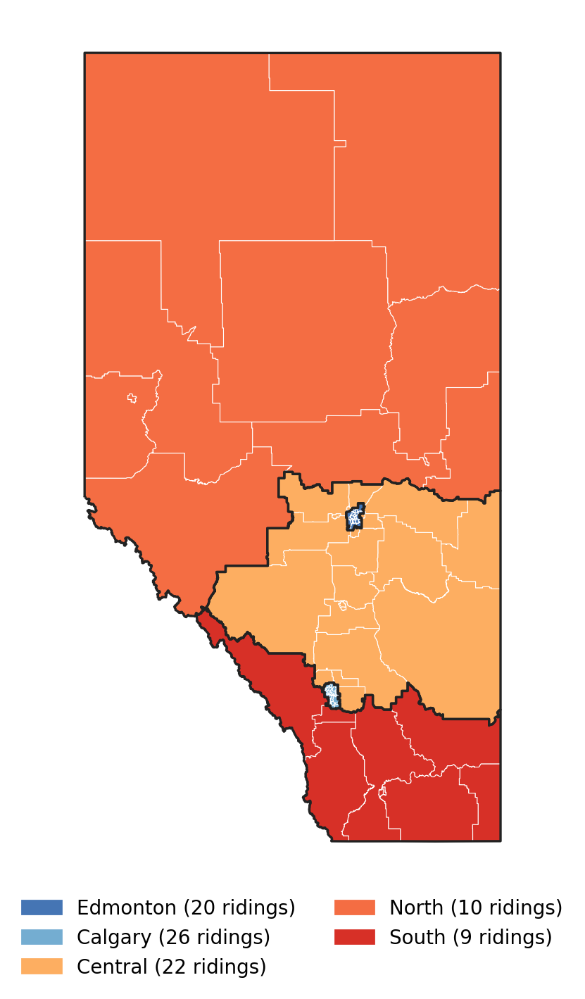{#fig-regions width="45%"}

To compare the referendum with party support, we use Elections Alberta's official results for the 2019 and 2023 provincial general elections [@electionsalberta2023], which were held on the same 2017 boundaries, so every riding matches exactly. A party's share is its votes as a percentage of valid ballots in the riding. In each riding the candidate votes sum to the valid ballots, and the provincial totals reproduce the published results (UCP 52.6% and NDP 44.0% in 2023; UCP 54.9% and NDP 32.7% in 2019). Three small parties serve as indicators of separatist sentiment: the Alberta Independence Party in 2019, which ran in 63 ridings, and The Independence Party of Alberta and the Wildrose Independence Party in 2023, which together ran in 15. Where a party had no candidate, the riding is excluded from that comparison rather than counted as zero.

Turnout is ballots cast divided by the elector count printed in the division workbooks. Those elector counts are higher than the count in the news release, so riding-level turnouts are a few points below the headline provincial figure of 70.4%.

## Measures

For Question 10, the outcome is the **Option 2 share**: Option 2 votes as a percentage of valid votes in a riding. Because the two options sum to 100%, every result for Option 2 applies in mirror image to Option 1, and Moran's I is identical for both.

To compare questions we define **support** as the Yes share for questions 1 to 9 and the Option 2 share for Question 10. On every question this is the side asking for more provincial authority or for change, so support can be compared directly across the ballot.

## Spatial dependence

Neighbours are defined by **queen contiguity**: two ridings are neighbours if their boundaries touch at an edge or a corner. To absorb small gaps left by boundary simplification, ridings within 500 m of each other in NAD83 / Alberta 10-TM (a metric projection) are treated as touching. Every riding has at least one neighbour. The weights matrix $W$ is row-standardised. As a sensitivity check we also use the 3, 5, 7 and 10 nearest ridings, measured between centroids in the same projection.

Global clustering is measured with Moran's I [@moran1950],

$$
I = \frac{n}{\sum_{i}\sum_{j} w_{ij}} \cdot \frac{\sum_{i}\sum_{j} w_{ij}(y_i - \bar{y})(y_j - \bar{y})}{\sum_{i}(y_i - \bar{y})^2},
$$

where $y_i$ is the outcome in riding $i$. Significance comes from a permutation test: the observed values are reassigned to ridings at random `{python} n_perm` times, and the one-sided p-value is the share of permutations with an I at least as large as observed (so the smallest attainable value is 0.0001).

Ridings in the same region are both similar and adjacent, so a high Moran's I could reflect regional differences alone. To separate the two, we subtract each region's mean from its ridings and compute Moran's I on the residuals, which measures clustering *within* regions.

Local clustering uses local Moran's I [@anselin1995]. Each riding is classified by its own standardised value and the average of its neighbours' as High-High (a hotspot), Low-Low (a coldspot), High-Low or Low-High. Significance uses conditional permutation: the riding's own value is held fixed and its neighbours are replaced by random draws from the other ridings, `{python} n_perm` times. Ridings with a pseudo p-value of 0.05 or more are reported as not significant. With 87 tests at this level about four false positives are expected by chance, so we interpret the overall pattern rather than individual borderline ridings.

## Comparing the ten questions

Agreement between questions is measured by the Pearson correlation of riding-level support across the 87 ridings, and by the share of total variance captured by the first principal component of the ten-by-ten correlation matrix. Region-level support is computed from summed votes, so larger ridings carry more weight.

To find ridings where Question 10 departed from the rest of the ballot, we regress each riding's Question 10 support on its average support across questions 1 to 9, using a quadratic fit because the relationship curves at low levels of support. The residual is the riding's **departure**: the number of percentage points by which its Question 10 result was above or below what its other answers predict. We test whether departures are themselves clustered with Moran's I. We also compute a **carry-over ratio**, Question 10 support divided by average support on questions 1 to 9, which expresses how much of a riding's support for the other proposals extended to separation.

## The referendum and the party vote

For each question we report the correlation across ridings between support and the UCP's 2023 share, and the difference between them: how far a question's support ran above or below the governing party's own vote in the same place. Region-level differences use summed votes for both the referendum and the election. To test whether the party vote accounts for the referendum's geography, we fit Question 10 support on the 2023 UCP share with a quadratic and compute Moran's I on the residuals, as for the departures above.

To test whether past votes mark the ridings that departed from the pattern on Question 10, we correlate the departures with five election measures: the Alberta Independence Party share in 2019, the combined share of the two 2023 independence parties, the Freedom Conservative Party share in 2019, the change in the UCP share from 2019 to 2023, and the UCP share in 2023. Significance comes from `{python} n_perm` random permutations of one variable, two-sided. We report all five tests and make no correction for multiple comparisons, so individual p-values near 0.05 should be read with caution.

Elections and referendums have different electorates and turnout, three years apart. A riding's referendum support falling below its UCP share does not show that UCP voters in that riding voted against a proposal; it shows that the proposal did worse there than the party had.

## Turnout

The association between turnout and Option 2 share is measured with Spearman's rank correlation, across all ridings and within each region.

## Scope and software

All quantities are measured at the riding level. They describe places, not voters: a riding that supported two questions did not necessarily do so through the same people, and no claim here should be read as a statement about individual behaviour. The analysis uses Python [@python] with pandas [@pandas], GeoPandas [@geopandas] and Matplotlib [@matplotlib]. Every number, table and figure in this paper is produced by `notebooks/06-spatial_analysis.ipynb`.

# Results

## Separation lost almost everywhere, though the map makes it look closer

Option 2 received `{python} q10_o2` votes to Option 1's `{python} q10_o1`, or `{python} q10_share` of valid votes. It won a majority in `{python} str(n_maj)` of 87 ridings, `{python} maj_ridings`, both by less than one percentage point. Its weakest result was `{python} pc(R["q10_min_pct"])` in `{python} min_riding`.

The divide was between the two large cities and everywhere else (@fig-q10-map). No riding in Calgary or Edmonton gave Option 2 more than `{python} city_max`, below the provincial result, while the median North riding gave it `{python} pc(med["North"])` and the median Central riding `{python} pc(med["Central"])`. Every one of the 20 strongest ridings for Option 2 lies outside the two cities.

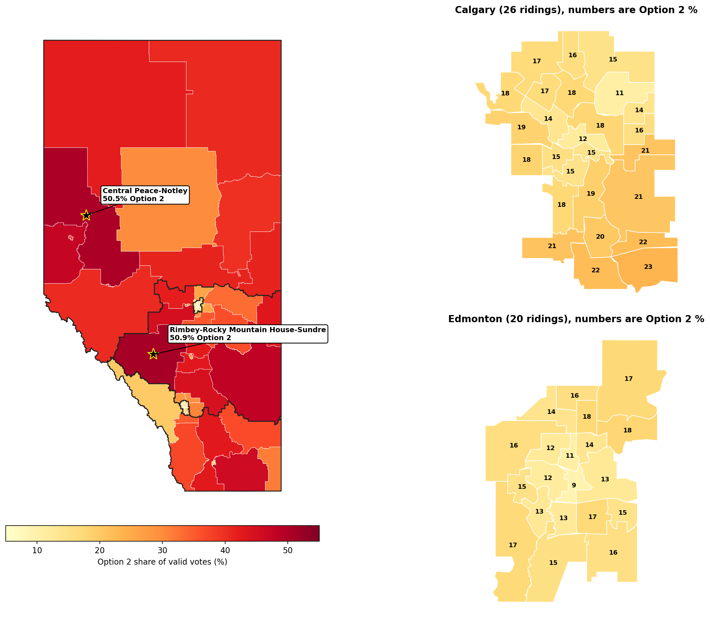{#fig-q10-map}

A map coloured by riding overstates Option 2, because the ridings that supported it most cover most of the province's land (@fig-land-votes). The North covers `{python} north_land` of Alberta's land area but cast `{python} north_votes` of valid votes. Calgary and Edmonton together cover well under 1% of the land but cast `{python} city_votes` of valid votes, and even with low Option 2 shares they supplied `{python} city_o2` of all Option 2 votes. The largest single source of Option 2 votes was Central Alberta, with `{python} central_o2` of the total from `{python} central_votes` of the vote. The largest block of the separation vote, in other words, came from Central Alberta, the rural areas, towns and suburbs between and around the two cities, rather than from the sparsely populated north.

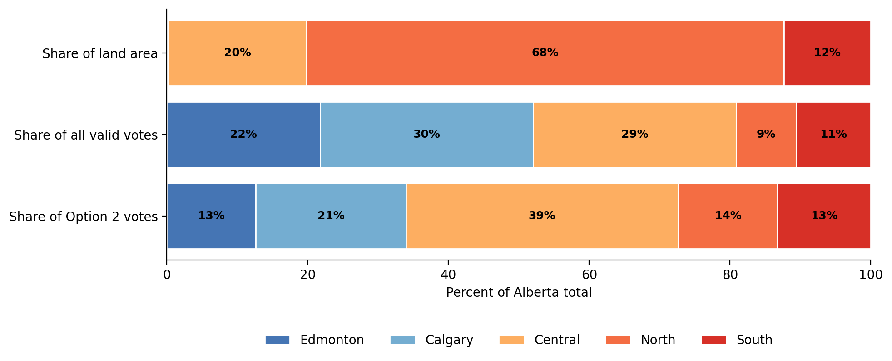{#fig-land-votes}

## Support is clustered, and the clusters are regions

Neighbouring ridings voted alike. With shared-border neighbours, Moran's I for the Option 2 share is `{python} moran`. None of the `{python} n_perm` random reassignments came close (the largest was `{python} perm_max`), giving p = 0.0001, the smallest attainable value. The result does not depend on how neighbours are defined: with the 3 to 10 nearest ridings, I ranges from `{python} sens_min` to `{python} sens_max`, falling as more distant ridings are counted as neighbours.

Most of this clustering is the difference between regions. After subtracting regional means, Moran's I falls to `{python} moran_within` (p = `{python} p_within`). Some clustering remains within regions, but it is weak: a riding's region predicts most of what its neighbours' results would.

The local analysis shows the shape of the divide (@fig-lisa). `{python} str(lisa["High-High"])` ridings are significant hotspots: every riding in the North (`{python} str(hot.get("North", 0))`), `{python} str(hot.get("Central", 0))` in rural Central Alberta and `{python} str(hot.get("South", 0))` in the southeast around Medicine Hat, Brooks and Cardston. They form one contiguous area. `{python} str(lisa["Low-Low"])` ridings are significant coldspots, all in the older, central parts of Edmonton (`{python} str(cold.get("Edmonton", 0))`) and Calgary (`{python} str(cold.get("Calgary", 0))`). No riding is a significant outlier. The remaining `{python} str(lisa["Not significant"])` ridings, including the outer city ridings, the suburbs and towns around both cities, Red Deer, Lethbridge and the southwest foothills, sit between the two blocs.

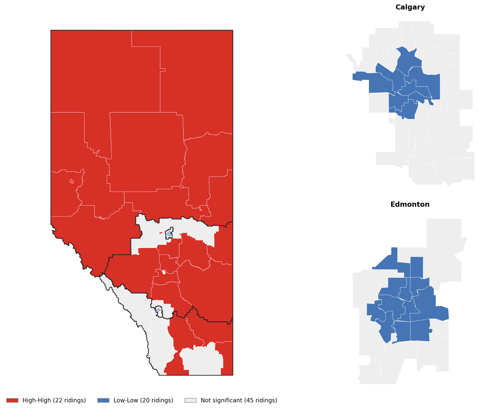{#fig-lisa}

## Ten questions, one map

The other nine questions split the province in the same way. Questions 1 to 5 won majorities province-wide and questions 6 to 9 did not (@tbl-questions). Support ranged from `{python} pc(q_support.max())` on `{python} q_support.idxmax()` to `{python} pc(q_support.min())` on `{python} q_support.idxmin()`, which was `{python} pts(q_support.drop(q_support.idxmin()).min() - q_support.min(), 0)` points below any other question.

```{python}
#| label: tbl-questions
#| tbl-cap: "Province-wide support, riding-level range and spatial clustering for each question. Support is Yes for questions 1 to 9 and Option 2 for Question 10. Moran's I uses shared-border neighbours; every value has p = 0.0001. 'Within regions' is Moran's I after removing regional means."
tab = questions[["Support, province (%)", "Ridings with majority support", "Lowest riding (%)",
                 "Highest riding (%)", "Moran's I", "Moran's I within regions"]].copy()
tab.columns = ["Support (%)", "Ridings > 50%", "Lowest (%)", "Highest (%)", "Moran's I", "I within regions"]
for col in ["Support (%)", "Lowest (%)", "Highest (%)"]:
    tab[col] = tab[col].map("{:.1f}".format)
for col in ["Moran's I", "I within regions"]:
    tab[col] = tab[col].map("{:.2f}".format)
tab["Ridings > 50%"] = tab["Ridings > 50%"].astype(int).astype(str)
md_table(tab.reset_index().rename(columns={"Question": "Question"}), [30, 11, 11, 11, 11, 11, 11], "lrrrrrr")
```

Within every question, ridings disagreed widely, by `{python} spread_min` to `{python} spread_max` percentage points between the lowest and highest riding (@fig-all-ridings). In every case the city ridings sit at the low end and the North and Central ridings at the high end. What changes from question to question is where 50% falls in that ordering: questions 1 to 5 won a majority in `{python} str(imm_maj.min())` to `{python} str(imm_maj.max())` ridings, questions 6 to 9 in `{python} str(con_maj.min())` to `{python} str(con_maj.max())`, and Question 10 in `{python} str(n_maj)`.

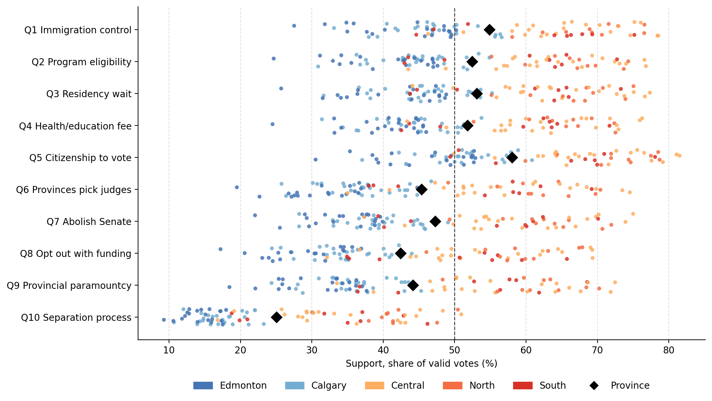{#fig-all-ridings}

The questions are close to interchangeable as maps (@fig-ten-maps). Every pair of questions correlates at `{python} corr_min` or higher across ridings, and a single shared pattern accounts for `{python} first_pattern` of the variation in support across all ten questions. Every question is clustered to the same degree (Moran's I from `{python} moran_q_min` to `{python} moran_q_max`), and on every question most of that clustering is regional (`{python} within_q_min` to `{python} within_q_max` within regions). The regions keep the same order on all ten questions (@fig-region-support): the North gave the most support and Edmonton the least, the gap between them was `{python} gap_min` to `{python} gap_max` points, and Calgary was `{python} ce_min` to `{python} ce_max` points more supportive than Edmonton throughout.

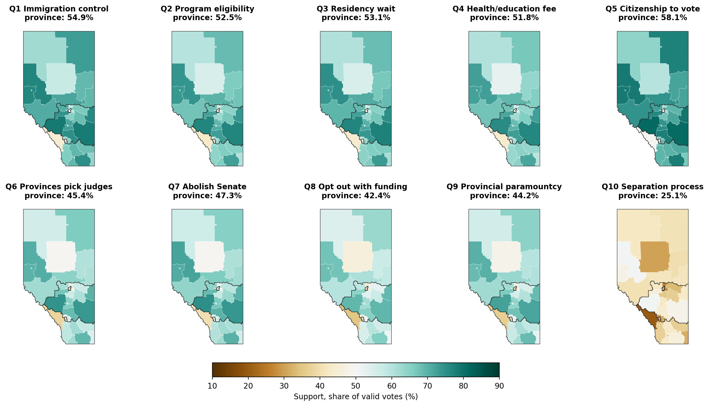{#fig-ten-maps}

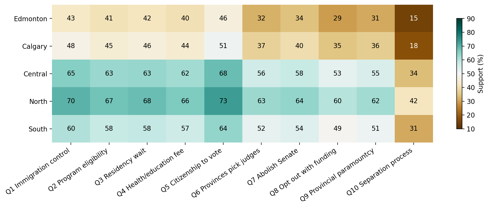{#fig-region-support}

The ballot therefore did not reveal ten separate geographies of opinion. It measured one urban–rural divide ten times, at different levels. The two groups of questions differ slightly in where their support came from: the gap between the immigration and voting questions and the constitutional questions was widest in Edmonton (`{python} pts(block["Edmonton"])` points) and Calgary (`{python} pts(block["Calgary"])`) and narrowest in the North (`{python} pts(block["North"])`). City voters were relatively more open to the immigration proposals than to constitutional change.

## The referendum followed the governing party's vote, at different heights

The single geography of the referendum is close to the geography of the UCP vote. Across ridings, every question's support correlates with the party's 2023 share at `{python} pc_min` to `{python} pc_max` (@fig-party). The questions differ in where they sit against that vote. The immigration and voting questions ran close to it: their support exceeded the UCP share in `{python} str(above_ucp.iloc[0:5].min())` to `{python} str(above_ucp.iloc[0:5].max())` of 87 ridings. The constitutional questions ran below it, exceeding the UCP share in at most `{python} str(above_ucp.iloc[5:9].max())` ridings and falling `{python} pts(-gap_to_ucp.iloc[5:9].max(), 0)` to `{python} pts(-gap_to_ucp.iloc[5:9].min(), 0)` points short on average. Question 10 fell below the UCP share in all 87 ridings, by `{python} pts(-gap_to_ucp.iloc[9], 0)` points on average.

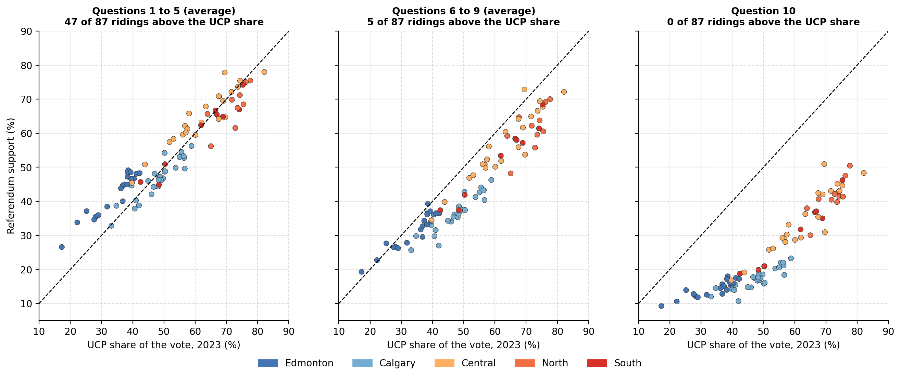{#fig-party}

The regional breakdown shows where each group of questions found support beyond the party (@fig-party-gap). In Edmonton, where the UCP took `{python} pc(ucp_reg["Edmonton"], 0)` of the 2023 vote, the immigration and voting questions ran `{python} pts(edm_imm.min(), 0)` to `{python} pts(edm_imm.max(), 0)` points above it: these proposals drew support from well outside the governing party's electorate. Elsewhere they ran within a few points of the UCP vote. The constitutional questions fell short of the UCP vote in every region. Question 10 fell short by `{python} pts(q10_short.min(), 0)` to `{python} pts(q10_short.max(), 0)` points, most in `{python} q10_short_most`. In the North, where the UCP took `{python} pc(ucp_reg["North"], 0)` of the vote, separation drew `{python} pc(regions_q10.loc["North", "Option 2 share (%)"], 0)`.

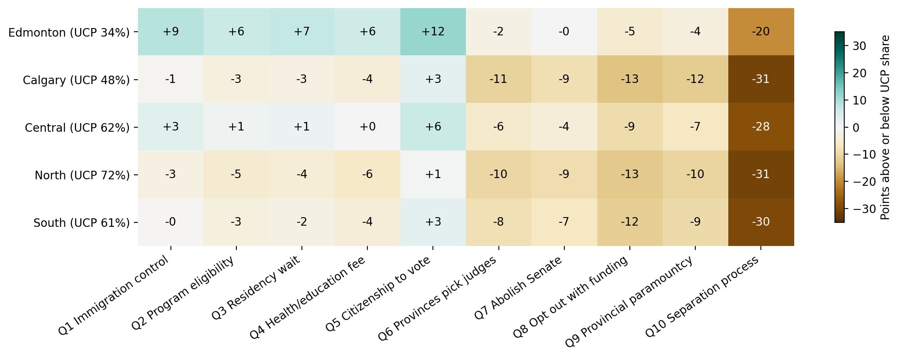{#fig-party-gap}

The party vote does not, however, account for all of the referendum's geography. The 2023 UCP share explains `{python} pc(100 * R["r2_ucp"], 0)` of the variation in Question 10 support across ridings, but the remainder is still spatially clustered (Moran's I = `{python} i2(R["moran_resid_ucp"])`, p = 0.0001). Neighbouring ridings miss the party-based prediction in the same direction, so some of the regional pattern in the separation vote is not a reflection of 2023 partisanship. The other referendum questions predict Question 10 better (`{python} pc(100 * R["r2_others9"], 0)`, with leftover clustering of `{python} i2(R["moran_resid_others9"])`).

## Separation sits at the far end of the same divide, below a ceiling

Question 10 drew from the same places as every other question, but its support was not a fixed fraction of theirs. In the `{python} str(R["n_all_nine"])` ridings where all nine other proposals won a majority, Option 2 ranged from `{python} pc(R["q10_all_nine_min"])` to `{python} pc(R["q10_all_nine_max"])`, with a median of `{python} pc(R["q10_all_nine_median"])`; only `{python} str(R["q10_all_nine_over_50"])` crossed 50%. In the `{python} str(R["n_none_nine"])` ridings where none of the nine won a majority, almost all in the two cities, the median was `{python} pc(R["q10_none_nine_median"])`.

The carry-over ratio shows how this ceiling varied (@fig-carryover). The median Edmonton riding gave Question 10 `{python} i2(carry["Edmonton"])` times its average support for the other proposals, and the median Calgary riding `{python} i2(carry["Calgary"])`, against `{python} i2(carry["Central"])` in Central, `{python} i2(carry["South"])` in the South and `{python} i2(carry["North"])` in the North. Across ridings, carry-over rose almost in step with support for the other proposals (correlation `{python} i2(R["carryover_corr"])`). Where the other proposals were popular, Question 10 kept more than half of their level of support; where they were unpopular, it kept well under half. Even in its strongest territory, separation fell well short of the majorities the other proposals won there.

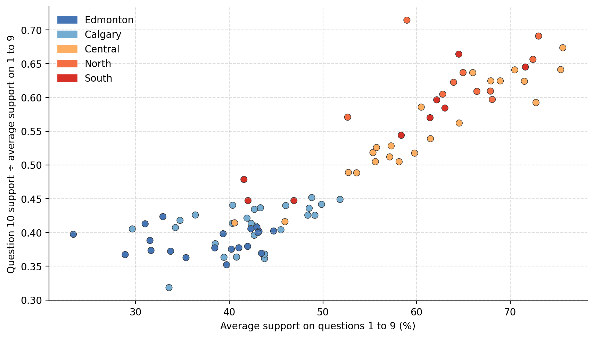{#fig-carryover}

## Where separation broke from the pattern

Because Question 10 tracked the other questions so closely, the ridings that departed from that relationship are informative. A riding's average support on questions 1 to 9 accounts for `{python} curve_r2` of the variation in Question 10 support (@fig-q10-vs-others). The departures are small, mostly within a few points, but they are not random: they cluster geographically (Moran's I = `{python} gap_moran`, p = `{python} gap_p`).

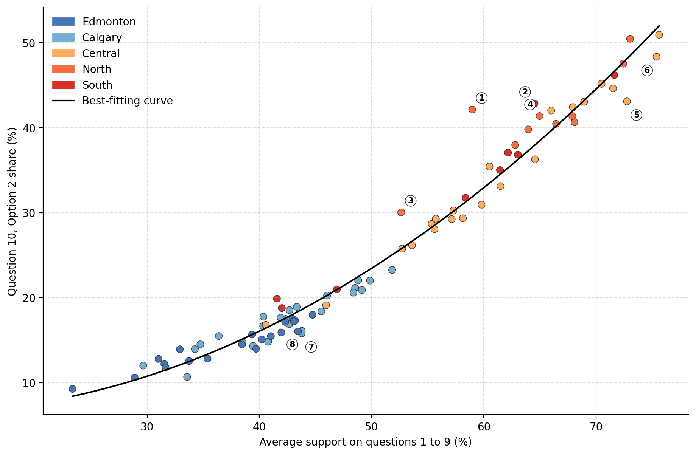{#fig-q10-vs-others}

```{python}
#| label: tbl-departures
#| tbl-cap: "Ridings whose Question 10 result departed most from what their answers to questions 1 to 9 predict. Positive values mean more Option 2 support than predicted."
dep = departures.rename(columns={"riding": "Riding", "region": "Region", "gap_points": "Departure (points)"})
dep.index = range(1, len(dep) + 1)
dep["Departure (points)"] = dep["Departure (points)"].map("{:+.1f}".format)
md_table(dep.rename_axis("Label").reset_index(), [8, 45, 17, 25], "rllr")
```

The largest positive departure was `{python} top_dep["riding"]`, where Option 2 ran `{python} pts(top_dep["gap_points"])` points above prediction, followed by `{python} next_up_text`. On average, northern ridings gave separation `{python} pts(gap_reg["North"])` points more than their other answers implied, and southern ridings `{python} pts(gap_reg["South"])` points more (@fig-q10-gap). The largest negative departures were in east-central Alberta, led by `{python} low_dep["riding"]` (`{python} pts(low_dep["gap_points"])` points), and in a group of Calgary ridings. These ridings stopped further short of separation than their answers on the other nine questions would predict.

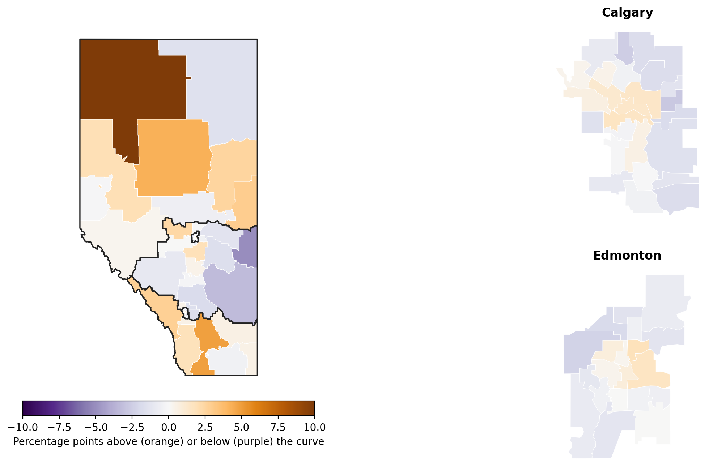{#fig-q10-gap}

Past elections only faintly mark these ridings (@tbl-separatist). Departures were larger where the Alberta Independence Party did better in 2019 (correlation `{python} i2(R["aip_corr"])` across `{python} str(R["aip_n"])` ridings, p = `{python} f"{R['aip_p']:.3f}"`), although that party never won more than `{python} pc(R["aip_max"])` of a riding's vote (@fig-aip). They were also larger where the UCP's share rose more, or fell less, between 2019 and 2023 (correlation `{python} i2(R["swing_corr"])`, p = `{python} f"{R['swing_p']:.3f}"`), the first election after Danielle Smith became party leader. The UCP's 2023 share itself was unrelated to the departures, so the association is with the movement of the party's vote, not its level. Both correlations are weak, each accounting for less than a tenth of the variation, and they are two significant results among five uncorrected tests. They suggest where to look rather than explain the departures; doing so would require data on who lives in each riding.

```{python}
#| label: tbl-separatist
#| tbl-cap: "Correlation between each riding's Question 10 departure and election measures, with two-sided permutation p-values. Ridings without a candidate from the party are excluded."
sep = separatist.reset_index()
sep["Correlation with departure"] = sep["Correlation with departure"].map("{:+.2f}".format)
sep["p"] = sep["p"].map("{:.3f}".format)
sep["Ridings"] = sep["Ridings"].astype(int).astype(str)
md_table(sep, [52, 12, 24, 12], "lrrr")
```

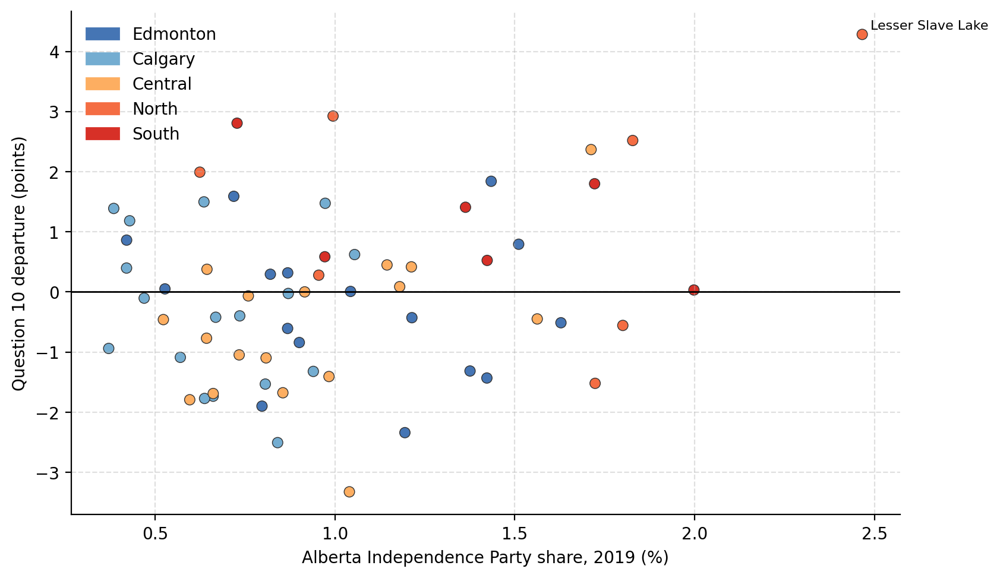{#fig-aip width="75%"}

## Turnout does not account for the pattern

Turnout varied from `{python} pc(R["turnout_min_pct"])` in `{python} R["turnout_min_riding"]` to `{python} pc(R["turnout_max_pct"])` in `{python} R["turnout_max_riding"]`, and was lowest in the North (median `{python} pc(t_med["North"])`). Across all ridings, the rank correlation between turnout and Option 2 share was `{python} rho`. Within regions the relationship was sometimes moderate but ran in opposite directions, positive in the North (`{python} i2(rho_reg["North"])`) and Calgary (`{python} i2(rho_reg["Calgary"])`) and negative in the South (`{python} i2(rho_reg["South"])`), Central (`{python} i2(rho_reg["Central"])`) and Edmonton (`{python} i2(rho_reg["Edmonton"])`), with 9 to 26 ridings per region. There is no consistent association between how many people voted in a riding and how it voted on separation.
